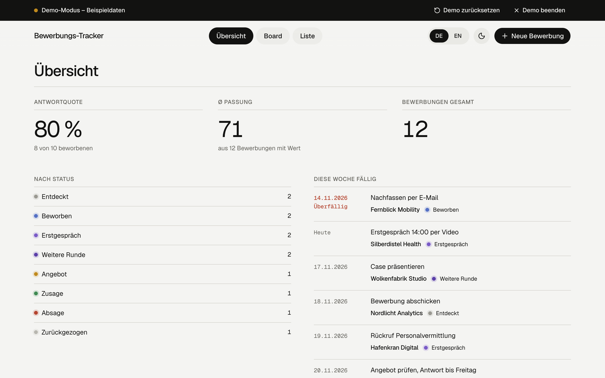
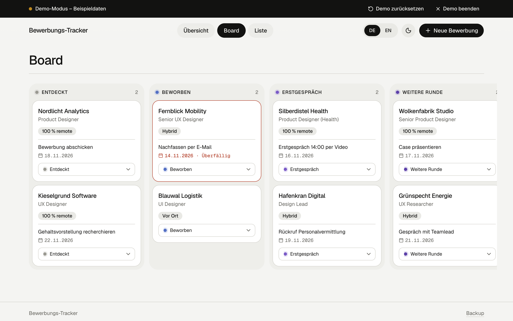
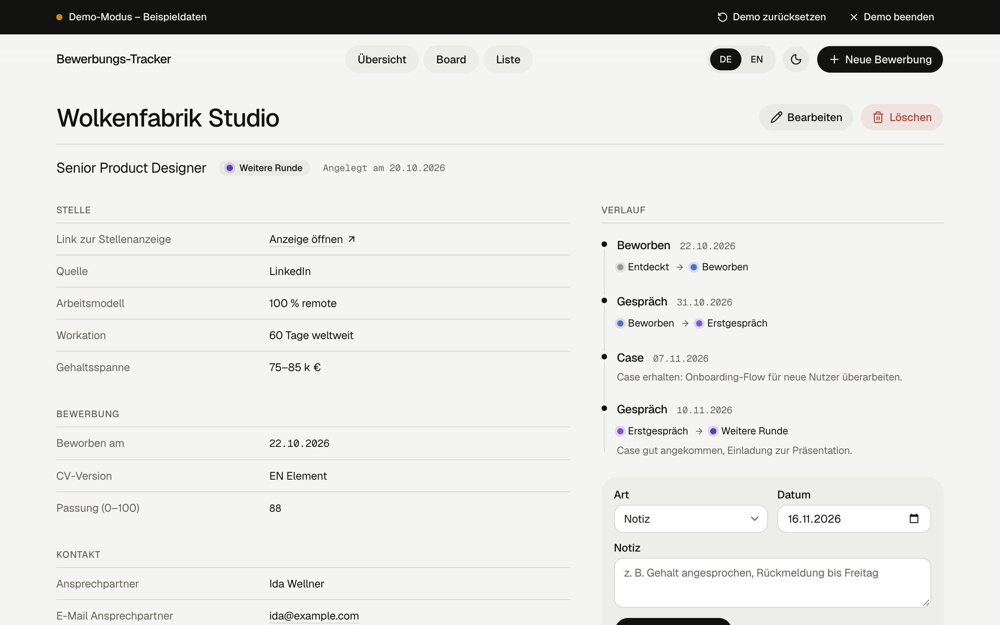
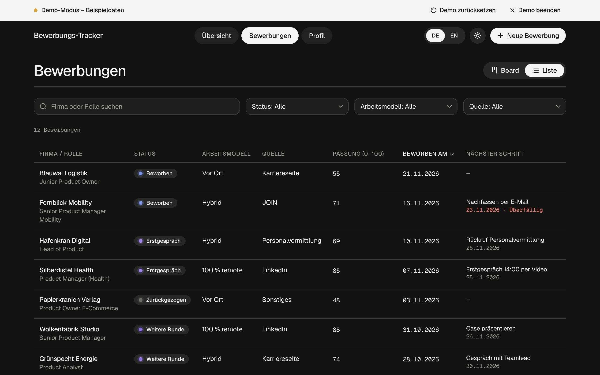
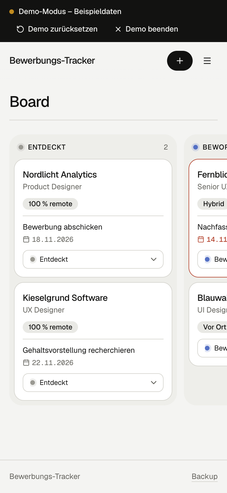

# Bewerbungs-Tracker

Alle Bewerbungen an einem Ort: Status, Gesprächstermine, offene Fragen und die passende CV-Version, statt verteilt auf Mails, Chats und Notizen. Die Web-App zeigt auf einen Blick, wo jede Bewerbung steht und was als Nächstes ansteht.

Das Projekt ist zugleich ein Portfolio-Nachweis: Es ist Schritt für Schritt mit KI (Claude Code) entstanden. Wie genau, steht in [PROZESS.md](PROZESS.md).

**Live:** <https://bewerbungstracker-bice.vercel.app> · Ohne Anmeldung ausprobierbar, mit einem Klick auf **„Demo ansehen“**.



## Funktionen

- **Stellenanzeige per KI auslesen:** Link oder Text einer Anzeige einfügen, die KI füllt Firma, Rolle, Arbeitsmodell, Workation, Gehalt und Pflichtanforderungen vor. Fehlende Angaben bleiben leer statt geraten, gespeichert wird erst nach eigener Prüfung.
- **Board:** Kanban-Ansicht nach Status, Karten per Drag & Drop verschieben (Maus, Touch, Tastatur). Auf dem Handy ändert man den Status alternativ über ein Auswahlfeld. Überfällige nächste Schritte sind markiert.
- **Liste:** Tabelle mit Filtern (Status, Arbeitsmodell, Quelle), Suche nach Firma oder Rolle und Sortierung nach Datum, Passung und nächstem Schritt.
- **Detailseite:** alle Angaben auf einen Blick und bearbeitbar, dazu ein Verlauf mit automatisch protokollierten Statuswechseln und eigenen Einträgen (Gespräch, Case, Notiz …).
- **Übersicht:** Antwortquote, durchschnittliche Passung, Anzahl je Status und „Diese Woche fällig“.
- **Backup:** Export als JSON-Datei und Import mit gründlicher Prüfung. Ungültige Dateien werden abgelehnt, ohne Daten zu verändern.
- **Demo-Modus:** 12 erfundene Beispiel-Bewerbungen mit Verlauf, getrennt von den eigenen Daten gespeichert.
- **Deutsch/Englisch** umschaltbar, **Hell/Dunkel** (Standard: Systemeinstellung), responsiv für Desktop und Handy.

| Board | Detailseite mit Verlauf |
|---|---|
|  |  |

| Liste (dunkel) | Handy |
|---|---|
|  |  |

## Datenschutz und Speicherung

Es gibt keine Datenbank und kein Konto. Alle Daten liegen im `localStorage` des eigenen Browsers, jeder Besucher sieht nur seine eigenen Daten. Einzige Ausnahme ist der KI-Import: Nur wenn man ihn ausdrücklich startet, gehen der eingefügte Text bzw. der Inhalt der verlinkten Seite über eine Server-Funktion an die Claude-API von Anthropic. Gespeicherte Bewerbungen werden dabei nie übertragen. Werden die Browserdaten gelöscht, sind auch die Bewerbungen weg. Davor schützt nur der Export, die App weist auf der Seite „Backup“ darauf hin.

## Tech-Stack

- [Next.js](https://nextjs.org) 16 (App Router) mit TypeScript; alle Seiten werden vorab statisch gebaut, dazu eine einzelne Server-Funktion für den KI-Import
- [Claude API](https://docs.claude.com) (Modell Claude Haiku 5.5) mit festem Ausgabeformat (Structured Outputs) für das Auslesen von Stellenanzeigen
- [Tailwind CSS](https://tailwindcss.com) 4 und [shadcn/ui](https://ui.shadcn.com) (auf Basis von Base UI)
- [dnd-kit](https://dndkit.com) für Drag & Drop
- Eigene kleine Storage-Schicht mit Schema-Version, auf Basis von `useSyncExternalStore`
- Eigenes Design-System, beschrieben in [DESIGN.md](DESIGN.md)
- Deployment auf [Vercel](https://vercel.com)

## Lokal starten

Voraussetzung: [Node.js](https://nodejs.org) 20 oder neuer.

```bash
git clone https://github.com/Fransen58/bewerbungstracker.git
cd bewerbungstracker
npm install
npm run dev
```

Danach läuft die App unter <http://localhost:3000>.

Für den KI-Import wird ein eigener API-Schlüssel von Anthropic gebraucht. Er gehört in eine Datei `.env.local` im Projektordner (wird nicht eingecheckt):

```bash
ANTHROPIC_API_KEY=sk-ant-…
```

Ohne Schlüssel funktioniert alles andere wie gewohnt, der Import meldet dann nur, dass er nicht eingerichtet ist.

## Projektdokumente

- [SPEC.md](SPEC.md): Produkt-Spec mit User Stories und Akzeptanzkriterien
- [DESIGN.md](DESIGN.md): Designkonzept und Tokens
- [PROZESS.md](PROZESS.md): Entstehung mit Claude Code, Story für Story
- [CLAUDE.md](CLAUDE.md): Arbeitsanweisungen für Claude Code in diesem Projekt

---

## English summary

**Application Tracker** is a web app for keeping track of job applications in one place: status, interviews, open questions and the CV version used. Data stays in the browser (`localStorage`, no database, no login); the only server part is an optional AI import that reads a job ad (link or pasted text) with Claude and pre-fills the form for review and can be tried instantly via **“Try the demo”**.

**Live:** <https://bewerbungstracker-bice.vercel.app>

Features: AI job ad import, Kanban board with drag & drop, filterable and sortable list, detail page with editable fields and history, dashboard (response rate, average fit, due this week), JSON backup import/export with validation, demo mode with separate sample data, German/English UI and light/dark theme.

The project was built step by step with Claude Code as a portfolio piece. The process (approach, decisions, prompts, problems and learnings) is documented in [PROZESS.md](PROZESS.md) (German).

**Run locally:** `npm install && npm run dev`, then open <http://localhost:3000>.
